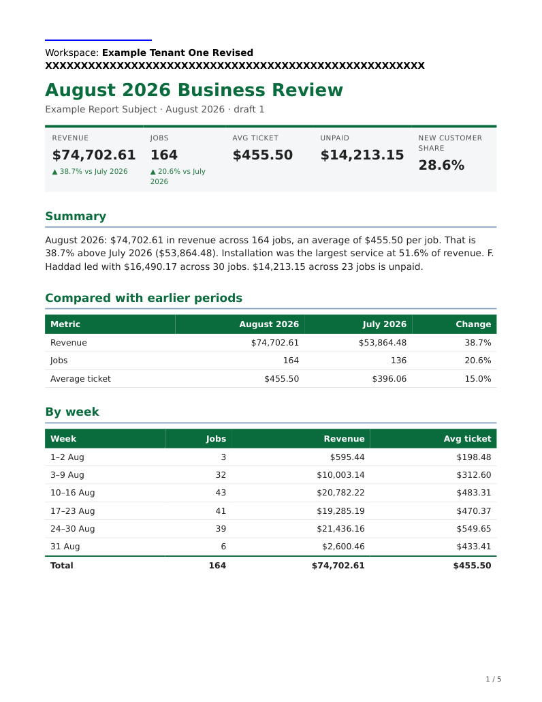

# Complete offline report presentation

Each `build`, `prose`, `render` and explicit single-file export captures one
complete current presentation before drawing charts or rendering formats. The
selected product/provider, tenant name, sanitized image bytes and effective
report palette stay together for that operation. Source replacement or removal
cannot replace individual fields midway through its formats. The next command
validates its current selection again.

Saved downloads never regenerate themselves. New renders publish a separate
bundle under the existing source comparison, locks and immutable-draft rules.
These are display inputs, not tenant assignment, resource ownership or access
permissions. Report commands do not activate readers or restore deployments.



This actual PDF page uses synthetic data. The shared product/provider block
remains separate in the document’s end matter.

## Inputs and owners

Strict reports reuse the [workspace tenant projection](TENANT_PRESENTATION.md)
and [offline product envelope](OFFLINE_REPORT_PRODUCT_IDENTITY.md), including
canonical digests and their existing schemas. Use the operator's installed
backend, the same effective configuration and admitted immutable inputs as the
Gateway, outside active report mounts:

```bash
uv run --no-sync --project backend python -m deerflow.config.product_identity_export --include-default > /absolute/new-staging/product-identity.json
uv run --no-sync --project backend python -m deerflow.config.tenant_presentation > /absolute/new-staging/tenant-presentation.json
```

The second output contains protected tenant data. Restrict its custody and logs.
It must be a complete `tenant` or explicit `product-only` projection, not the
legacy response. `--include-default` permits the exact admitted default product
name with null product assets/provider, preserving the same product envelope.
It supplies binding evidence without inventing provider attribution. The ordinary
product export still refuses unconfigured mode unless this option is supplied.
Configured HTML/PDF retain their separate shared product/provider block; default
identity binding does not print that block. DOCX does not add shared attribution.

Expose both files using the existing operator-controlled sandbox mounts and
environment, alongside any independent tenant settings:

```yaml
sandbox:
  mounts:
    - host_path: /absolute/operator/admitted-report-presentation
      container_path: /mnt/presentation
      read_only: true
  environment:
    HARTMESH_REPORT_PRODUCT_IDENTITY: /mnt/presentation/product-identity.json
    HARTMESH_REPORT_PRODUCT_SHA256: <product envelope sha256>
    HARTMESH_REPORT_TENANT_PRESENTATION: /mnt/presentation/tenant-presentation.json
    HARTMESH_REPORT_TENANT_SHA256: <tenant projection snapshot_id>
```

The tenant projection binds to the complete selected product identity. Both
selector pairs are required for strict reports, including strict tenants bound
to default product identity. A partial pair, unavailable file, unsupported mode,
unknown/duplicate field or mismatch refuses; failed strict reads never imply
legacy or product-only. Expected digests are operator selections, not signatures,
authorization or an independently discoverable current deployment generation.
Protect these inputs and selectors from ordinary report writers.

The tenant input is at most 384 KiB, with an exact integer version 1, explicit
mode and product binding. A tenant needs its complete name and inline static
RGBA PNG: 1–80 plain Unicode characters, at most 256 KiB and 1–1024 pixels on
each axis. The reader reuses the product reader's PNG framing, CRC, full decode
and re-encoding checks; only already sanitized IHDR/IDAT/IEND projections are
retained. No live asset path or URL supplies a strict logo. Normalized absolute
POSIX paths, no-follow reads and regular singly linked files are required.

Without tenant selectors, the existing `--tenant`/`/mnt/tenant` tolerant reader
selects a complete current legacy brand once. Missing/invalid legacy fields
still degrade before capture. PNG/JPEG logos are decoded and sanitized once;
legacy source images are bounded to 2 MiB and 4096 pixels, reduced to at most
1024 pixels and 256 KiB. Unsupported images degrade to the admitted name.
Coherent activation keeps legacy inputs immutable during a command too;
uncoordinated live edits are not an activation procedure. Renderers never reopen
legacy logo paths. Legacy name validation retains its existing policy rather than silently imposing strict Unicode rules.

Strict mode ignores unrelated loose `brand.json`; that file cannot supply a
palette, product or provider override. Only the two existing report preference
colors, `brand.primary` and `brand.secondary`, override report defaults. Builds
use their validated effective preferences, including an explicit temporary
override. Prose/regeneration use the source bundle's exact verified
`preferences-used.json` effective choices. They do not read or update current
preferences/profile files or reanalyse source exports. Unsupported fields or
values refuse. Strict primary must support both primary text on white and white
table headings on primary at 4.5:1; secondary is a decorative rule, not text.
The tenant name uses fixed black/white text (21:1). No arbitrary theme is added.

`meta.company` remains report content: an explicit company/issuer/subject, or a
frozen label inherited from a legacy build. `meta.brand.company` is also retained
content, not proof of operator presentation. A differing value appears as
**Saved label** rather than being silently renamed or promoted to tenant identity.
Strict new builds do not infer a business company from the tenant. Current tenant
presentation appears separately as **Workspace** in HTML/PDF and DOCX. Historical
company fields, authored prose, dates, currency, rows, checks and input provenance
survive branding-only rendering unchanged. The passive view retains content and
actual export references, with neutral styling instead of an old saved accent.

## Bundles, charts and migration

New bundles retain `presentation.json` (at most 16 KiB), optional
`presentation/tenant.png`, the selected `product-identity.json`, and bounded
`chart-data.json` as supporting members under existing `renders.json` hashes.
The presentation record binds its mode, source snapshot, product digest, effective
palette, tenant label and relative asset/hash. Strict source identity can be
reconstructed from its retained complete bytes. Record/asset edits, missing
members, unsafe references and unsupported versions refuse before reuse. The
report model and passive-view v1 schemas stay unchanged; no separate snapshot
store or lifecycle ledger exists.

The retained presentation is evidence of that bundle, not implicit selection
for another operation. Historical selection is not a command option; incomplete
or incompatible saved fragments never repair a failed current selection. Use
an unchanged old download, or have the operator admit a complete compatible
current restoration. A historical tenant snapshot bound to another product
cannot be restored by overlaying current product fields.

HTML/PDF may be carried only when the complete effective presentation is the
same and report content is unchanged. DOCX requires compatible tenant bytes and palette; product-only changes
do not add attribution to Word. XLSX contains the unchanged report facts and
may be carried when those facts are unchanged. Incompatible formats are omitted
unless selected for regeneration. Only actual staged formats appear in the new
manifest, passive-view exports and command output. Older bundles keep their bytes.

Build retains the original chart draw values/specs, bounded to 4 MiB, 64 charts,
4096 values per chart and 32767 characters per label. A name/logo-only change can
reuse verified chart pixels when retained data and affected primary match. A
changed primary redraws those retained values using the selected palette; it
never reruns models, rereads CSV/XLSX inputs or applies changed calculation/profile
preferences. Drawing does not calculate new business facts.

Older loose reports are not verified historical presentations. Adjacent valid
retained chart data can be imported as logical report input and redrawn; old
filename-only format lists never establish format ownership. If chart values
are missing, presentation-affected rendering refuses clearly: retain old outputs
or explicitly rebuild from the source inputs. Chart-free legacy reports still
render. An explicit XLSX-only export does not consume chart pictures and remains
available without them. These are bounded migration/refusal rules, not an archive
converter. Historical `preferences-used.json` bytes are copied exactly; no command
rewrites that evidence to look current.

The existing publication contract remains: prepare privately, compare the exact
current source under the commit lock, durably publish one complete new directory,
then update the current pointer. A renderer failure/interruption preserves prior
bundles and pointer. Failure after directory rename can leave a complete
unadopted bundle; its message identifies that uncertainty. No multi-file atomic
replacement or automatic operator recovery is claimed. Explicit exports cannot
replace bundle members and name success only after their actual file is published.

## Activation and real mount boundaries

Use the existing operator serialization, authorization, stop/drain, staging,
restart and admission procedure for both dependencies. Validate/export outside
active mounts. Verify the intended product/tenant binding against the actual
admitted Gateway workers, not merely a separate validator or generic health
response. Keep all affected report commands stopped while changing their inputs
and expected selectors. Preserve independently changed settings and report roots.

Recreate every affected sandbox/container when its mounts or environment change.
Do not infer new bytes from a host pathname, symlink target or successful host
replacement. A file bind can retain the old inode after `os.replace`; a directory
bind may expose new bytes with the old expected digest. A stale or uncertain
runtime cannot be reported current. Verify actual read-only mount behavior,
selected bytes and expected digests in each recreated runtime before admission.
The installed skill's `capture_presentation` reader can perform this read-only
operator check with the supported Python; compare its `source_id` and
`product_identity.digest` with the approved selections. Commands perform the same
validation themselves, once per operation, and refuse stale/incompatible inputs.

Restore A on current software/settings through that same complete procedure,
without restoring output directories, preferences, profiles or business data.
After interruption, reconcile actual readers before reopening admission. The
exporter/reader does not coordinate workers, select a tenant or independently
retry an operator transition. Old skill versions that ignore these selectors
are incompatible; deploy the matching reader, skill and runtime exposure together.

The local Docker proof below establishes file-bind staleness and recreation for
that provider/runtime. Remote/provisioner providers and other filesystems need
their existing read-only volume mechanisms and actual reader verification. A
LocalSandbox's virtual mappings alone do not provide shell isolation or read-only
custody. No Gateway/frontend package is assumed importable in the report runtime.

## Qualification

Use prepared dependencies; install nothing in a running sandbox. The offline
image checker runs actual build/prose/render/export commands with independent
CSV totals, HTML, PDF text/embedded logo pixels/page bounds, DOCX image dimensions,
XLSX values, retained hashes/preferences and A/B/A, product-only, isolated tenant,
default/legacy and strict/default-product cases. Inputs and skill are read-only,
network is disabled, and no Gateway package/service is used:

```bash
docker run --rm --network none --cap-drop ALL --security-opt no-new-privileges --user 1000:1000 --entrypoint python3 \
  --volume "$PWD/skills/public/business-report:/mnt/skill:ro" \
  --volume "$PWD/backend/tests/skills/business_report:/mnt/qualification:ro" \
  <sandbox-image@sha256:digest> /mnt/qualification/check_presentation_reports_on_image.py \
  --skill /mnt/skill --fixtures /mnt/qualification/fixtures --output /tmp/report-presentation-proof
python3 backend/tests/skills/business_report/check_presentation_mounts.py \
  --image <sandbox-image@sha256:digest> --skill skills/public/business-report \
  --fixtures backend/tests/skills/business_report/fixtures --output <fresh-task-owned-directory>
```

The second test replaces a real host file, observes old bytes in the running
read-only bind, verifies stale command refusal, recreates the reader, then
renders complete B and restored A while preserving old bundles and report facts.
Sandbox Image Smoke CI runs both checks against its actual built image. Required
HTML/PDF cases must execute with zero skips when claiming implementation. Source
qualification and a runtime image used with mounted new source do not establish
publication: record the delivering release, source and relevant artifact digests
and artifact-linked qualification separately.
