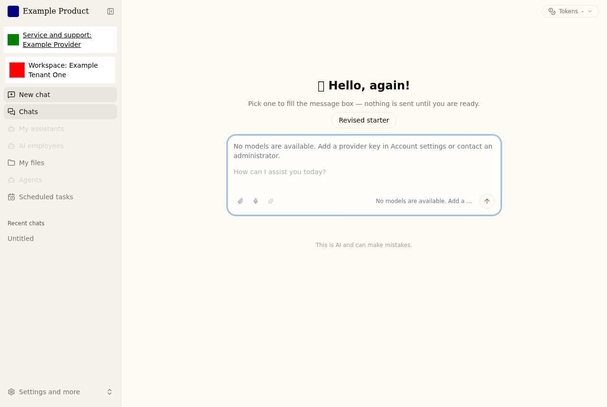

# Authenticated workspace presentation

Tenant presentation identifies the workspace after sign-in. It never chooses a
tenant, grants access, renames a conversation, changes stored resources, or
replaces the shared product/provider. Browser title/icon, sign-in/setup, product
information, component version and support retain their product-owned roles.
The strict UI shows a separate **Workspace** name/logo, including a meaningful
name in collapsed navigation. It uses the existing text/background palette;
tenant-controlled CSS, colors and themes are not supported.



This production-build example uses synthetic names and raster marks. Product
and support stay separate from the tenant's Workspace context.

## Compatibility and ownership

`tenant_bundle.presentation: legacy` is the default, preserving the existing
tolerant `brand.json` reader and live metadata/logo behavior. Missing or invalid
legacy fields degrade independently. Its logo route has a short private cache;
legacy mode does not promise coherent snapshots during live edits. Legacy color
metadata is consumed by report skills, not applied as workspace CSS.

Opt in with `strict-v1`. A directory containing starters, roles or report
settings does not select a presentation mode. Strict mode requires an explicit
`presentation.json`, even for product-only presentation. It ignores legacy
`brand.json` for web presentation; that file remains independently owned by
legacy/report consumers. `starters.json`, `roles.json`, report profiles and
other settings keep their owners and refresh behavior. The reader never writes,
copies, enumerates or restores those resources. Report/sandbox snapshots are a
separate contract; this change does not activate them.

Use matching Gateway/frontend versions for strict mode. Older frontends cannot
display the strict tenant context; the Gateway suppresses loose tenant branding
in features and refuses the old live-logo route in that mode. A new frontend
requires a versioned presentation response, including explicit legacy mode.
A pre-contract or misrouted Gateway's 404 is unavailable; upgrade the pair together.
An absent/invalid strict response is unavailable, never implicit product-only.
Static demo builds retain their existing fixture behavior and do not qualify
protected tenant delivery. Strict delivery requires normal verified sessions;
auth-disabled/internal/PAT provenance is not a substitute. Browser content
verification requires a secure context (HTTPS, or localhost for local testing).

## Strict input

Configure the existing mounted directory as read-only to every Gateway reader:

```yaml
tenant_bundle:
  path: /operator/tenant
  presentation: strict-v1
  presentation_sha256: <canonical-presentation-json-sha256>
```

The manifest has exactly these fields, with no unknown/duplicate keys:

```json
{
  "schema_version": 1,
  "mode": "tenant",
  "product_sha256": "<canonical-public-product-identity-sha256>",
  "tenant": {
    "name": "Example Tenant One",
    "logo": {"path": "logo.png", "sha256": "<exact-source-file-sha256>"}
  }
}
```

For explicit product-only mode, set `mode` to `product-only` and `tenant` to
`null`. Retain `schema_version` and the product binding. No tenant identity is
inferred from unrelated files or from the report company/issuer.

Canonical JSON uses sorted keys, separators `(',', ':')`, `ensure_ascii=True`
and `allow_nan=False`, encoded as ASCII; its SHA-256 is lowercase hex. Compute
the product binding over the entire admitted public
`GET /api/v1/auth/product-identity` object, including its sanitized asset bytes.
The existing operator product exporter emits this same identity and digest.
The independently supplied manifest digest pins the complete selection; a logo's
source digest binds its exact bytes before decoding. Neither digest authorizes
operations or proves deployment readiness.

Version is integer `1` (not boolean). Tenant mode requires both name and logo.
Names contain 1–80 Unicode scalar characters, without surrounding whitespace,
controls, format characters, surrogates or line/paragraph separators. The logo
is a basename matching `[A-Za-z0-9_-]{1,80}.png`. Absolute paths, traversal,
symlink ancestors/files, hardlinks and non-regular files refuse. Strict capture
requires POSIX no-follow descriptor support; unsupported hosts refuse instead
of weakening traversal. The manifest is at most 16 KiB. Logo source and sanitized
PNG are each at most 256 KiB; dimensions are 1–1024 pixels on each axis. Only a
complete static PNG with raster/color chunks is admitted. Framing, CRC, actual
decoding, dimensions and animation are checked; metadata/active carriers,
trailing data, fake headers and oversized input refuse. Pixels are re-encoded
as a metadata-free RGBA PNG. The full response is capped at 384 KiB.

Unknown presentation fields, product/provider overrides, colors, incomplete
modes, unsupported versions, unreadable files and mismatched product/assets
refuse the whole strict presentation. Diagnostics contain fixed text, never
operator values or paths.

## Reader and document boundary

Each Gateway worker captures the presentation selection at startup and validates
its selected input. Successful admission retains complete metadata and sanitized
bytes in memory; it never reopens the live logo path. Failed capture can recover
only from a complete input matching the same pinned selection. Activation of
another selection requires restarting every affected worker. General service
health is not presentation readiness.

`GET /api/branding/presentation` is behind the existing authentication middleware.
Strict responses additionally require verified session provenance. Its complete
versioned response includes `mode`, `product_sha256`, `tenant` (name plus inline
sanitized PNG, or null), and `snapshot_id`. The latter is the canonical hash of
the complete response without `snapshot_id`, a bounded content fact only.
Responses use `Cache-Control: private, no-store`, `Vary: Cookie, Authorization`
and `nosniff`. No tenant assets or metadata are added to public product APIs,
static assets, sign-in, setup or public HTML.

The authenticated frontend fetches this complete response once per account and
browser-document lifetime, using credentials and no-store. It validates the
schema and content hash and compares the product binding with the document's
already admitted product snapshot. It retains the entire selection across
client navigation, focus, feature refreshes and server refreshes. A new full
page load fetches the current complete selection, including with warm caches.
Late responses belong to their retired lifetime and cannot update another.
Logout/account/role retirement unmounts protected state and cancels pending
reads; another lifetime must pass the existing session checks again. A fresh
failure displays **Workspace identity unavailable** with Reload. It does not
render partial tenant context; an already admitted document may retain its
complete snapshot during a reader outage.

The workspace index's existing pure server redirect runs before private
presentation admission, preserving entry queries during an auth-service outage.
This route-only slot exposes no workspace chrome or tenant data. The same
presentation provider stays mounted across client entry/return navigation, so
the redirect cannot replace an already admitted document snapshot.

Healthy and uncertain server auth refreshes keep the same account/provider
component path. A newly delivered conflicting server account/role/permission scope clears
private state and triggers an explicit full-page reload for fresh existing auth
checks. It never applies late server props as a new client account. Logout
retires this monitor together with the protected account subtree.
Once retired, later uncertain or older server responses cannot reopen private
children before that reload or account retirement. Verified client auth refreshes
retain their existing account-retirement behavior; unchanged initial server props
do not override that newer verified admission.

## Operator activation and restoration

This is a bounded read-only reader interface, not an activation controller.
The operator owns authorization, serialization, staging, traffic admission,
stopping/restarting and recovery. Arbitrary live edits are unsupported.

1. Stage a complete manifest/logo in an operator-owned immutable directory.
   Bind it to the selected public product identity. Retain earlier valid inputs
   if restoration is required. Update only presentation-owned files/settings;
   do not replace a directory containing independently managed resources.
2. Compute and independently select the manifest digest in configuration. Mount
   the directory read-only through the existing deployment interface. Validate
   as the actual Gateway user in the actual runtime/config environment:
   `uv run --no-sync --project backend python -m deerflow.config.tenant_presentation`.
   This explicit local command emits protected metadata; keep it out of shared
   logs. It reads and validates, and grants no authorization/admission.
3. Close new reader admission and stop every affected Gateway worker. Stage the
   selection at its mounted location and restart all those workers. Recreate
   containers when changing bind sources; replacing host paths alone does not
   establish which bytes an existing bind mount sees. Keep selected inputs
   immutable while workers capture them.
4. Through ordinary verified authentication, check the **actual serving**
   `/api/branding/presentation` on every worker against the selected complete
   snapshot, then inspect a fresh authenticated page's readable name/logo and
   shared product/provider/version. A separate validation subprocess or generic
   health endpoint cannot establish what another worker admitted. Do not report
   readiness or reopen admission while any worker is mixed, failed or uncertain.
5. Existing browser documents may keep their admitted presentation. New full
   loads obtain the current selection. The frontend server has no tenant asset
   cache or tenant startup payload and needs no branding restart; browser
   readers need a full load. Restart the frontend only when its application or
   ordinary runtime settings require it.

To restore earlier presentation A after B on current software, repeat the same
procedure with A's complete inputs/digest and current product binding. A bound
to a different product is incompatible and refuses; prepare/approve a complete
compatible input rather than overlaying fields. Preserve independently changed
starters, roles, report settings, conversations, files, access and identifiers.
Unknown schemas refuse before admission. After interruption, keep admission
closed until actual reader state is reconciled. The helper never overwrites a
directory, restores unrelated state, selects a tenant or independently retries
an operator transition. There is no registry, builder, watcher or lifecycle ledger.

## Real browser qualification

The opt-in `tests/e2e/tenant-presentation-live.spec.ts` uses real session cookies,
the real Gateway and one production frontend build. Its fixture mounts current
app/harness/extension API source read-only over an already loaded digest-pinned
Gateway runtime image, and mounts presentation input read-only. It uses no
external model or API mocks. It qualifies that source/runtime combination,
separately from publication of a new application artifact.

From the repository root, choose a fresh task-owned directory and an available
immutable image, then use the prepared environments:

```bash
export HARTMESH_TENANT_GATEWAY_IMAGE=ghcr.io/altakleos/hartmesh-backend@sha256:<digest>
export HARTMESH_TENANT_TEST_DIR=/tmp/tenant-presentation-qualification
uv run --no-sync --project backend python backend/tests/support/tenant_presentation_live.py prepare --directory "$HARTMESH_TENANT_TEST_DIR"
```

Build/start production Next on port 18110 with
`DEER_FLOW_INTERNAL_GATEWAY_BASE_URL=http://127.0.0.1:18111`, auth enabled,
task-owned `NEXT_DIST_DIR`/`NEXT_TSCONFIG_PATH` and temporary directories as in
the frontend guide. Keep that one build/server for the entire test:

```bash
HARTMESH_LIVE_TENANT_PRESENTATION=1 PLAYWRIGHT_SKIP_WEB_SERVER=1 PLAYWRIGHT_BASE_URL=http://127.0.0.1:18110 python3 scripts/pnpm.py --project frontend-hm -- exec playwright test tests/e2e/tenant-presentation-live.spec.ts --workers=1 --reporter=line
```

The fixture owns only labeled disposable containers and its marked directory.
The test exercises A/B/A at unchanged logo filenames, warm caches, old documents,
separate isolated inputs/accounts, default/legacy/product-only paths, strict
failures, actual private headers, long names/boundary dimensions, resource and
independent-setting preservation, delayed actual HTTP responses and session
retirement. Required opt-in browser cases must execute with zero skips when
claiming completion. Stop the task-owned frontend afterward. Release/version,
artifact digests and deployed delivery evidence remain separate.
